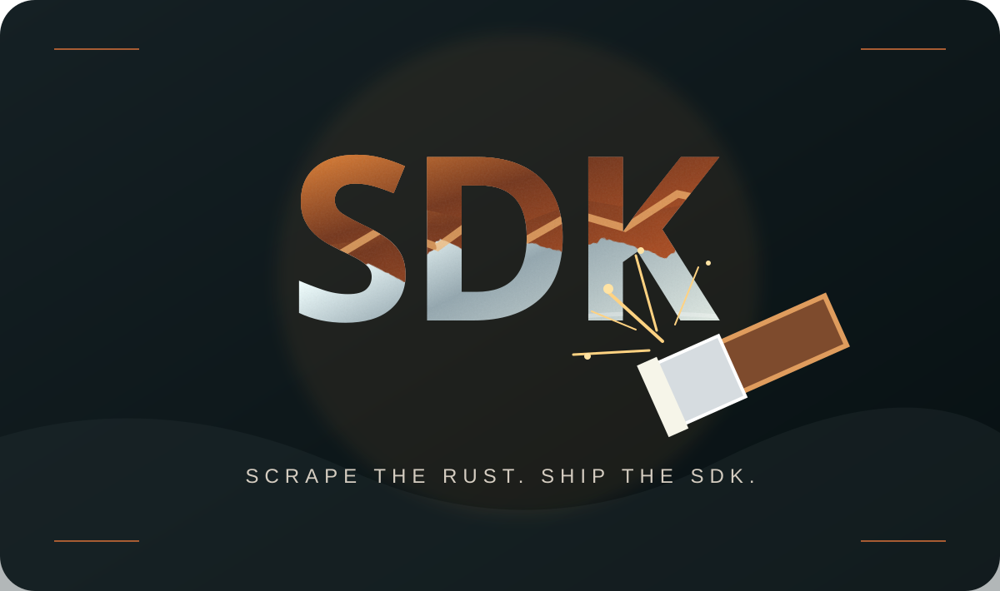

# Rust-eze — Universal Plugin SDK Platform

**A little rust on the SDK skills. A lot of TypeScript underneath.**



[](https://www.typescriptlang.org/) [](https://nodejs.org/) [](https://react.dev/) [](https://www.mysql.com/) [](LICENSE)

**Live demo:** [Rust-eze website](https://appdevdesign.com:8123/) · [React dashboard](https://appdevdesign.com:8123/dashboard/) · [API health](https://appdevdesign.com:8123/health) · [Postman collection](https://appdevdesign.com:8123/postman/Rust-eze.postman_collection.json)

> **Project purpose:** Rust-eze is a working, interview-ready full-stack demonstration of an extensible **TypeScript/JavaScript plugin SDK**. I built it to brush up on SDK design, plugin lifecycles, REST integration, and hands-on backend engineering. The rust-removal theme is a joke; the SDK is real.


## GraphQL demo (v4.3)

Rust-eze offers **GraphQL alongside REST** at `POST https://appdevdesign.com:8123/graphql`. Both APIs share the same `PluginRegistry`, MySQL, Storage, Notifications and event history. GraphQL is not an in-memory imitation: the `notes` and `addNote` resolvers call the real MySQL plugin.

- [GraphQL Workshop](https://appdevdesign.com:8123/graphql-playground.html) — interactive query and mutation examples.
- Authentication: `X-API-Key` header, same as REST. The published `booya-admin-key` is for this openly accessible demo only.
- Schema: query `plugins`, `events(limit:)`, `notes`, `health`, `executePlugin`; mutations `addNote`, `enablePlugin`, `disablePlugin`, `executePlugin`.
- `JSON` scalar supports plugin inputs and results. MySQL note date values remain ISO in the API; website UI uses the standard 24-hour MST format.

```bash
curl -sS https://appdevdesign.com:8123/graphql \
  -H 'X-API-Key: booya-admin-key' \
  -H 'Content-Type: application/json' \
  -d '{"query":"query { plugins { id name state operations } }"}'
```

```bash
curl -sS https://appdevdesign.com:8123/graphql \
  -H 'X-API-Key: booya-admin-key' \
  -H 'Content-Type: application/json' \
  -d '{"query":"mutation($text:String!){addNote(text:$text){id text}}","variables":{"text":"GraphQL SDK demo works!"}}'
```

A **GraphQL SDK Demo** folder with nine requests is included in the downloadable Postman collection. No Apache, Docker, new database schema, or TLS changes are needed.

## What it does

Rust-eze provides a reusable, typed plugin contract and registry, wrapped by a Fastify REST and GraphQL APIs. A public-facing website illustrates the architecture with rust-to-metal artwork and an interactive **browser simulation**; a separate **React dashboard** operates the real backend.

| Component | What it demonstrates |
| --- | --- |
| **TypeScript SDK** | Plugin contracts, registration, lifecycle transitions, execution routing, and events |
| **Fastify server** | JSON REST and GraphQL endpoints, Zod input validation, API-key check, and error responses |
| **MySQL plugin** | Real database connection, table initialization, parameterized insert, and record retrieval |
| **Storage plugin** | Isolated UTF-8 file reads/writes and directory listing |
| **Notifications plugin** | In-memory simulated message dispatch and history; **no email is sent** |
| **React dashboard** | Plugin status, enable/disable controls, operation execution, response viewer, and event log |
| **Rust-eze website** | Static landing page, SVG artwork, SDK playground, and downloadable Postman tests |
| **Testing** | Vitest tests, shared date-format tests, curl demo script, and Postman collection |

### Live URLs

The site runs on **HTTPS port 8123**, independently of Apache (which continues hosting other sites on ports 80/443).

| Destination | URL |
| --- | --- |
| Website | <https://appdevdesign.com:8123/> |
| SDK playground | <https://appdevdesign.com:8123/#playground> |
| React dashboard | <https://appdevdesign.com:8123/dashboard/> |
| GraphQL workshop | <https://appdevdesign.com:8123/graphql-playground.html> |
| GraphQL API (POST) | <https://appdevdesign.com:8123/graphql> |
| API health (public) | <https://appdevdesign.com:8123/health> |
| Plugin registry | <https://appdevdesign.com:8123/api/plugins> |
| SDK events | <https://appdevdesign.com:8123/api/events> |
| Postman collection | <https://appdevdesign.com:8123/postman/Rust-eze.postman_collection.json> |
| Postman environment | <https://appdevdesign.com:8123/postman/Rust-eze-HTTPS-8123.postman_environment.json> |

**API exposure:** The REST API is **intentionally internet-accessible for this demonstration**. `/health` is unauthenticated; `/api/*` endpoints require the `X-API-Key` header. The public sample/Postman key is `booya-admin-key` if the server's `.env` is configured to match. **This is a demo credential, not a security boundary.** Anyone who knows it can call state-changing operations, including writing files in the SDK's storage directory and adding notes. This configuration is **not appropriate for sensitive or production data**. Use separate authentication, authorization, rate limiting, access restrictions, and secret rotation before production use.

## Architecture

```text
Browser / Postman / React dashboard
                |
    HTTPS :8123 (Node.js / Fastify)
      |                      |
 Static website          REST API (/api/*) + GraphQL (/graphql)
      |                      |
 Browser simulation     SDK PluginRegistry
                             |
           +-----------------+------------------+
           |                 |                  |
       MySQL Plugin     Storage Plugin   Notifications Plugin
           |                 |                  |
       Rusteze DB       .data/files       In-memory history
```

**Current hosting:** Intel Mac running macOS Ventura 13.7.8, Node.js, Fastify and an existing local MySQL server. Node.js serves the website, dashboard and API on port 8123. **Apache is not modified or used as a proxy for Rust-eze.**

## Tech stack

TypeScript · Node.js · Fastify · React · Vite · MySQL (`mysql2`) · Zod · Vitest · tsup · HTML/CSS/JavaScript · macOS shell scripts · TLS (OpenSSL-compatible PEM certificate and key).

## Project structure

```text
rust-eze/
├── index.html, styles.css, app.js, date-format.js
├── assets/                    # Website illustrations and favicon
├── apps/
│   ├── api/                   # Fastify API and static website routes
│   └── dashboard/             # React administration dashboard
├── packages/sdk/              # Plugin interfaces and registry
├── plugins/
│   ├── mysql/                 # Persistent demo notes
│   ├── storage/               # Local file operations
│   └── notifications/         # Simulated notifications
├── database/schema.sql
├── config/
│   ├── database.env.example   # Copy to database.env; keep secrets private
│   └── tls.env                # Server-local certificate file paths
├── postman/                   # Postman collection and environments
├── scripts/                   # macOS startup, API tests, demo
├── deployment/                # Deployment references
├── .env.example
└── package.json
```

## Install and run on macOS

**Requirements:** Node.js 20+ and npm; MySQL 8.x running locally; an HTTPS certificate and private key if you plan to expose the server using TLS. The deployed Mac uses Node.js 22 and port 8123.

1. Clone the repository and install dependencies:

   ```bash
   git clone https://github.com/YOUR_GITHUB_USERNAME/rust-eze.git
   cd rust-eze
   npm install
   npm run build
   npm test
   npm run test:date-format
   ```

   Replace `YOUR_GITHUB_USERNAME` with your repository location after publishing, or open an already extracted project directory.

2. Set up MySQL with an application account (in the MySQL client, using an administrator account):

   ```sql
   CREATE DATABASE IF NOT EXISTS Rusteze CHARACTER SET utf8mb4 COLLATE utf8mb4_unicode_ci;
   CREATE USER IF NOT EXISTS 'rusteze'@'localhost' IDENTIFIED BY 'REPLACE_WITH_PASSWORD';
   GRANT ALL PRIVILEGES ON Rusteze.* TO 'rusteze'@'localhost';
   ```

   The MySQL plugin creates `demo_notes` on startup if needed. The table definition is also in [`database/schema.sql`](database/schema.sql). If the local MySQL account is restricted to another host or uses a different password, adjust it rather than changing unrelated MySQL accounts.

3. Copy the configuration files:

   ```bash
   cp .env.example .env
   cp config/database.env.example config/database.env
   ```

   Configure `.env`:

   ```dotenv
   PORT=8123
   API_HOST=0.0.0.0
   CORS_ORIGIN=https://appdevdesign.com:8123
   ADMIN_API_KEY=booya-admin-key
   ```

   Configure `config/database.env` for the **existing local MySQL server**:

   ```dotenv
   MYSQL_HOST=127.0.0.1
   MYSQL_PORT=3306
   MYSQL_DATABASE=Rusteze
   MYSQL_USER=rusteze
   MYSQL_PASSWORD=REPLACE_WITH_PASSWORD
   ```

   Only the dedicated application user credentials are needed. Never commit `.env` or `config/database.env`.

4. Configure HTTPS. The deployed Mac reuses the same public certificate files that Apache uses, **without changing Apache**. [`config/tls.env`](config/tls.env) holds filesystem paths, not private-key contents:

   ```dotenv
   TLS_CERT_FILE=/usr/local/etc/openssl@3/certs/appdevdesigndotcom/2026/appdevdesign.com.crt
   TLS_KEY_FILE=/usr/local/etc/openssl@3/certs/appdevdesigndotcom/2026/appdevdesign.com_key.txt
   TLS_CHAIN_FILE=/usr/local/etc/openssl@3/certs/appdevdesigndotcom/2026/appdevdesign.com.ca-bundle
   ```

   Update those paths for **your own machine**. The service user must be able to read the key without making it publicly readable. The server combines the leaf certificate and CA chain in memory. If TLS paths are unset, it starts as HTTP instead; do not expose administrative requests over unencrypted HTTP.

5. Start the service:

   ```bash
   bash scripts/start-macos.sh
   ```

   The script loads `.env`, `config/database.env`, and `config/tls.env`. For the public deployment, DNS and router TCP port-forwarding send external port 8123 to the Mac's port 8123. TLS certificate renewal requires a Node.js restart, and potentially updating paths if the certificate location changes.

**Local health check with hostname verification:**

```bash
curl --resolve appdevdesign.com:8123:127.0.0.1 \
  https://appdevdesign.com:8123/health
```

For a development machine using a different domain/certificate, use its matching hostname or a local HTTP configuration instead.

## REST API reference

All paths below are relative to `https://appdevdesign.com:8123`. Use `X-API-Key: booya-admin-key` for the demo unless you changed `ADMIN_API_KEY` in `.env`.

| Method | Endpoint | Description |
| --- | --- | --- |
| `GET` | `/health` | Health check, no key required |
| `GET` | `/api/plugins` | List plugin metadata, operations, and lifecycle status |
| `GET` | `/api/events` | Inspect in-memory SDK events |
| `POST` | `/api/plugins/:id/enable` | Initialize or re-enable a plugin |
| `POST` | `/api/plugins/:id/disable` | Stop a plugin |
| `POST` | `/api/execute` | Execute a named operation on a plugin |

Supported plugin identifiers: `mysql`, `storage`, and `notifications`.

| Plugin | Operation | Example input |
| --- | --- | --- |
| `mysql` | `addNote` | `{"text":"Rust removed; SDK restored!"}` |
| `mysql` | `listNotes` | `{}` |
| `storage` | `writeFile` | `{"name":"demo.txt","content":"Hello SDK"}` |
| `storage` | `readFile` | `{"name":"demo.txt"}` |
| `storage` | `listFiles` | `{}` |
| `notifications` | `send` | `{"recipient":"interviewer@example.com","message":"Hello!"}` |
| `notifications` | `history` | `{}` |

### cURL examples

```bash
export BASE_URL='https://appdevdesign.com:8123'
export ADMIN_API_KEY='booya-admin-key'

curl -sS "$BASE_URL/health"

curl -sS "$BASE_URL/api/plugins" \
  -H "X-API-Key: $ADMIN_API_KEY"

curl -sS -X POST "$BASE_URL/api/execute" \
  -H "X-API-Key: $ADMIN_API_KEY" \
  -H 'Content-Type: application/json' \
  -d '{"pluginId":"mysql","operation":"addNote","input":{"text":"Interview demo — MySQL works!"}}'

curl -sS -X POST "$BASE_URL/api/execute" \
  -H "X-API-Key: $ADMIN_API_KEY" \
  -H 'Content-Type: application/json' \
  -d '{"pluginId":"mysql","operation":"listNotes","input":{}}'
```

To verify persistence independently:

```bash
mysql -h 127.0.0.1 -u rusteze -p Rusteze \
  -e 'SELECT id, text, created_at FROM demo_notes ORDER BY id DESC LIMIT 5;'
```

**Postman:** Download the [collection](postman/Rust-eze.postman_collection.json) and [HTTPS environment](postman/Rust-eze-HTTPS-8123.postman_environment.json), import both, select the environment, and run Health → Plugin registry → MySQL insert → MySQL list. Test storage, notifications and lifecycle controls afterward. The collection includes the public sample key.

## React dashboard

Open **<https://appdevdesign.com:8123/dashboard/>** and enter the configured API key. From the dashboard you can inspect plugin state, enable/disable adapters, execute JSON operations, and read events. For demonstration purposes, the browser stores the entered key in **session storage**. The dashboard includes a few developer jokes, because a plugin lifecycle is serious enough already.

The main website has a separate **Browser simulation** mode that runs without the database. Choose **Live API + MySQL** to exercise the real SDK. Event dates on the website and dashboard are displayed as **`MM/DD/YYYY HH:mm MST`** (fixed UTC−07:00); API timestamps remain ISO 8601 UTC.

## Tests and development

```bash
npm test
npm run test:date-format
npm run typecheck
npm run build
```

For an end-to-end test **on a configured running server**:

```bash
set -a
source .env
set +a
BASE_URL=https://appdevdesign.com:8123 bash scripts/test-api.sh
```

The scripts and test collection are designed for a demonstration environment; some tests deliberately create records/files or change plugin state.

## Engineering talking points

- **Separation of concerns:** the host API knows about SDK contracts, not each adapter's internal implementation.
- **Extensibility:** new plugins implement the same lifecycle and `execute` interface and register with the SDK.
- **Lifecycle handling:** plugin enable/disable and startup errors are observable rather than silently ignored.
- **Practical persistence:** the MySQL adapter uses parameterized statements; storage and notification adapters demonstrate different side effects.
- **Standalone deployment:** a single Node.js HTTPS process hosts the full demo alongside an existing LAMP server, without modifying its Apache virtual hosts.
- **Tradeoffs to discuss:** API-key security, in-process plugin isolation, rate limiting, durable event storage, and stronger production observability are future hardening opportunities, not features claimed as implemented.

## Security and limitations

This is a **working portfolio demonstration, not a production-hardened SaaS platform**. Its HTTP API remains intentionally public over **HTTPS** for evaluation. The sample API key is deliberately included in the website's Postman assets. Do not store personal, confidential or production information in this environment. The API authorizes privileged calls with a single shared key; it does not provide per-user accounts or fine-grained permissions. Plugin code executes in-process, storage writes are confined to the configured demo directory, notifications are simulated and held in memory, and the SDK event log is in-memory rather than a durable audit store.

The only required persistence for this demonstration is the local `Rusteze` MySQL schema. Apache's ports **80 and 443** and other hosted sites remain independent. Private key contents and real database credentials must never be committed.

## Author and license

**Harold Paulino** — Software Engineer · SDK, mobile, backend and full-stack development.

MIT License — see [LICENSE](LICENSE). © 2026 Harold Paulino.

## Browse the Postman collection on the website

Open **[Postman Request Browser](https://appdevdesign.com:8123/postman-viewer.html)** to review all 33 requests, grouped by folder. Select an individual request to inspect its method, URL, headers, sample payload, test scripts, original Postman JSON, and a copyable cURL example. This viewer is read-only and never sends requests automatically.

Download the importable collection from **[Postman collection JSON](https://appdevdesign.com:8123/postman/Rust-eze.postman_collection.json)** and the **[HTTPS environment](https://appdevdesign.com:8123/postman/Rust-eze-HTTPS-8123.postman_environment.json)**. For the local standalone server, all three routes are served by Fastify on port 8123; Apache remains unchanged.


## GraphQL premade queries

The [GraphQL Workshop](https://appdevdesign.com:8123/graphql-playground.html) includes 21 searchable examples grouped under Getting started, MySQL, Storage, Notifications, Plugin lifecycle, and Schema explorer. Choose a query to populate the editable query and variables inputs, then click **Execute GraphQL**. Examples never autoexecute. State-changing mutations are labeled and described. Run `npm run test:graphql-examples` to verify the library.
